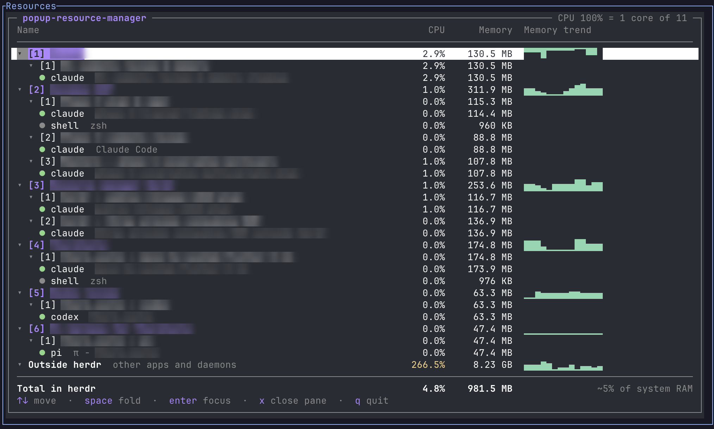

# Popup Resource Manager for herdr

When the fan spins up and six agents are running, Activity Monitor tells you that a few `node` and `claude` processes
are busy. It doesn't tell you which workspace they belong to. This plugin does. One key in [herdr](https://herdr.dev)
opens a popup with live CPU and memory for every workspace, tab and pane, and a row for everything else on the
machine. It's a single Rust binary for macOS and Linux.



<sub>Workspace and task names are blurred in the screenshot.</sub>

## Features

- CPU and memory per workspace, tab and pane. A pane is measured as its whole process tree, so an agent's language
  servers, build tools and test runs count towards the pane that started them.
- Agent state (working, blocked, idle) as a coloured dot, with the task title herdr reports for the pane.
- A memory trend per workspace, recorded while the popup is open.
- An Outside herdr row with the three busiest apps. More often than you'd think, the culprit is a browser, a
  simulator or a system daemon, not an agent.
- Worktree workspaces nested under the workspace of their main checkout.
- `enter` (or a second click) jumps to the selected workspace, tab or pane. `x` closes a pane after a `y/N` prompt.

## Requirements

- macOS (Apple silicon or Intel) or Linux (x86_64 or arm64)
- herdr 0.9.3 or newer

Installing downloads a prebuilt binary for your platform from this repo's GitHub releases and verifies it against
the release's `SHA256SUMS`. If there is no binary for your platform, no network, or the checksum doesn't match, it
builds from source instead, which needs Rust 1.95 or newer ([rustup.rs](https://rustup.rs)).

## Install

```sh
herdr plugin install Ruslanbek0809/herdr-popup-resource-manager
```

herdr plugins can't register their own keybinding, so add one to `~/.config/herdr/config.toml` and run
`herdr server reload-config`. `prefix+m` is only an example; any free key works.

```toml
[[keys.command]]
key = "prefix+m"
type = "plugin_action"
command = "herdr-popup-resource-manager.open"
description = "resource manager"
```

To uninstall, run `herdr plugin uninstall herdr-popup-resource-manager` and remove those lines.

## Keys and mouse

| Key | Action |
| --- | --- |
| `↑` `↓`, `j` `k`, `PgUp` `PgDn` | move the selection |
| `space` | fold or unfold a workspace, a tab or the Outside row |
| `enter` | focus that workspace, tab or pane in herdr and close the popup |
| `x` | close the selected pane (asks `y/N` first) |
| `q`, `esc` | quit |

Click a row to select it and click it again to jump there. Clicking the ▾ or ▸ arrow folds the row, and the scroll
wheel moves the selection.

## What the numbers mean

- **Panes** count the pane's shell and all of its descendants. Tab and workspace rows are the sum of their panes.
  Processes that detach from their parent (the Gradle daemon, the iOS simulator, `nohup` jobs) get a new parent
  (usually `launchd` or `init`), leave the pane's tree and show up under Outside herdr.
- **CPU** is per core and refreshed every second, so 100% is one fully busy core and a busy row can go well above
  that. The header shows how many cores you have. A process that starts and exits between two samples isn't seen.
- **Memory** is resident set size (RSS), summed over processes. Activity Monitor shows "memory footprint", a
  different measure, so the numbers won't match. Shared pages are counted once per process, which makes the totals
  run a little high, and "% of system RAM" a rough guide rather than an exact share.
- **Outside herdr** is every process that isn't in a herdr pane, the popup itself excluded. It lists the three apps
  using the most CPU. On macOS, helper processes are grouped under their `.app`.
- **The memory trend** starts when the popup opens. Its scale never shrinks below 5% of the row's peak, so small
  fluctuations stay flat instead of filling the chart.
- **Cost:** about 3% of one core while the popup is open (measured on macOS; the `ps` call is about 1.2% of that),
  and nothing when it's closed.

## What it runs

herdr doesn't sandbox plugins, so here is everything this one does.

- **On install and update**, `scripts/fetch-or-build.sh` downloads `herdr-popup-resource-manager-<platform>` and
  `SHA256SUMS` from the GitHub release matching the plugin version, verifies the checksum and places the binary in
  `target/release/`. On any failure it falls back to `cargo build --release --locked`.
- **On your keybinding**, `scripts/open.sh` checks that the binary exists and asks herdr to open the popup. If the
  binary is missing, you get a herdr notification instead.
- **While the popup is open**, it reads the process table once a second (`ps -A` on macOS, `/proc` on Linux) and
  asks herdr for the layout over its local socket (`session.snapshot`, `pane.process_info`). It calls
  `workspace.focus`, `tab.focus` or `pane.focus` only on `enter` or a click on the selected row, and `pane.close`
  only after `x` and `y`.
- The popup makes no network requests, writes no files and leaves no process running after it closes.
- Started outside herdr, it shows an error and `q` quits.

## Development

```sh
cargo test                                                # unit, integration and insta snapshot tests
cargo clippy --all-targets -- -D warnings
cargo build --release
./target/release/herdr-popup-resource-manager --once      # one sample as JSON (run inside herdr)
herdr plugin link "$PWD"                                  # use the local checkout; link doesn't build, so build first
```

State lives in a pure, Elm-style `update` function, and all IO (herdr socket, process table) sits behind traits, so
the tests run without herdr or a terminal. The fixtures in `tests/fixtures/` are captures from a real session with
personal details removed.

Pushing a `v*` tag runs `.github/workflows/release.yml`, which builds the binary for all four targets and publishes
them with `SHA256SUMS`. The tag has to match the version in both `Cargo.toml` and `herdr-plugin.toml`.

## License

MIT. See [LICENSE](LICENSE).
